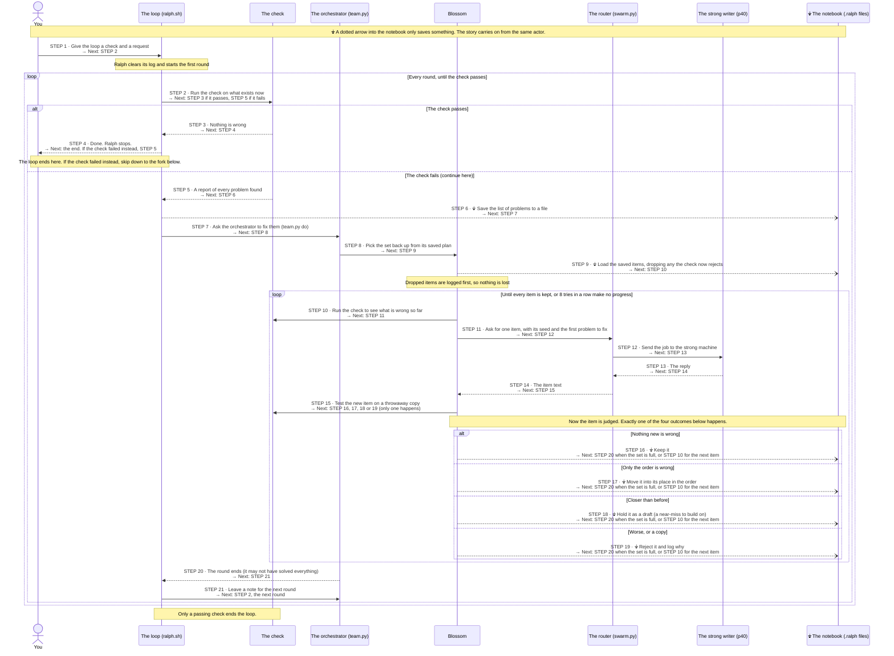

# How the swarm works: Ralph, the swarm, the team orchestrator and Blossom

## The one-minute story

**Several local AI models on your network write things for you. A script that you write decides whether each thing is good enough. A loop keeps asking until the script says yes.**

- **You** write the rulebook (called *the check*) and say what you want (the *request*).
- **The Loop** (Ralph) asks "are we done?" by running the rulebook. If not, it calls the orchestrator and tries again.
- **The Orchestrator** (team) reads what failed, decides what to ask for next, and hands the job to a machine.
- **The Router** (swarm) matches each job to the right computer on the network: hard jobs to the strong model, easy jobs to the small ones, never double-booking a machine, and learning from measurement how fast each one really is.
- **Blossom** is the data-generation framework, and the most valuable part. You give it a high-level objective and guidelines. It produces a large, varied set of outputs that all follow that theme, and the set can be sorted along axes of quality such as difficulty.

Why it works: the models are cheap and fast but sometimes wrong. The rulebook is exact. Nothing is kept unless the rulebook accepts it, so wrong output costs a retry, never a bad result.

---

A read-only map of how the pieces relate, written from `AGENTS.md`, `BLOSSOM.md`, `ralph.md`, `config.json`, `ralph.sh`, `team.py`, `swarm.py`, `judge.py`, `ground.py`, `codegen.py` and the example project `demo_platformer/`.

One-line definitions:

| name | what it is |
|---|---|
| **Ralph** (`ralph.sh`) | A bash loop. It repeats one unchanged request until the check exits 0. It holds no model logic. |
| **team** (`team.py`) | The orchestrator. `team.py do` plans, writes, gates and repairs. It also holds all of the Blossom code (`direct_stored` / `_store_outputs`). |
| **swarm** (`swarm.py`) | The node router and Ollama client: config, routing by difficulty, claims and leases, `chat_complete`, `pick_num_ctx`, cooldown, `state.db`. |
| **Blossom** | A data-generation framework: a project's objective and guidelines go in, a large set of varied outputs that follow the theme comes out, sortable along axes of quality. It is its own thing, not a mode of the other three. See "What Blossom is" below. |

The loop is `ralph.sh`. The node router is `swarm.py`. The orchestrator is `team.py`, which is also where the Blossom code currently lives. That is only where the code sits: Blossom is defined by what it does, below, not by the file.

---

## What Blossom is

**Blossom is a data-generation framework.** You tell it the high-level objective of the project, such as "fun geometric platformer levels that get steadily harder", and give it guidelines for what a good output looks like. It produces a large set of outputs that are valid, follow the theme, differ from each other in designed ways, and can be sorted by quality.

Four ideas make it work:

1. **A theme and guidelines, given to the writer as purpose, not just rules.** The writer is told what the project is for and what makes an output good or dull, then given the measurable rules as consequences of that purpose. A model that only sees numbers tunes to the edge of the numbers. A model that sees the purpose can aim at it. Every rule the check enforces is also stated to the writer before its first attempt.
2. **Axes of quality.** Before anything is written, Blossom works out the ways outputs can differ. Some axes *climb* from simple to demanding (for levels: gap width, climb height). Some are simply *different kinds* (layout, motif). This is what turns "40 different outputs" from a hope into a design.
3. **Seeds for prompt variation.** Each output is assigned its own position on the axes, and that position becomes its seed: a one-line brief that steers the writer ("a zig-zag of 12 platforms with 3-column gaps"). Asking the same model the same question 40 times gives 40 near-copies; giving each output its own seed gives 40 different ones. Seeds that produce identical results are rewritten.
4. **Sortable output.** Because every output sits at a known position on the quality axes, the finished set can be ordered by those axes, for example from easy to hard. The ordering is measured by the check, not guessed.

Every output is then tested against the guidelines. A good one is kept, a near-miss is repaired by showing the writer the first problem the check found, and a bad one is discarded. Nothing is accepted on a model's say-so alone: a script, or a cached and quote-checked judge for rules a script cannot measure, decides.

**What it can make.** Anything that comes as many members of one kind with a way to test them: game levels, written texts, records, test cases. Only the check changes. The platformer is one example, not the definition.

**Why it matters.** Models are good at producing one plausible thing and poor at producing many different good things on purpose. Blossom supplies the missing structure: the theme, the axes, the seeds, the test and the repair loop. It is the part of this project that produces something new.

---

## Readers' guide: how to read the charts

You do not need to know any code to follow the three charts. Each one is a map of *who hands work to whom*.

| What you see | What it means |
|---|---|
| **STEP 5, STEP 6B...** at the top of a box | The order things happen in. Follow the numbers upward. A letter (6B) is a sub-step, and *(optional)* means the system works without it. Under the headline, a sentence says what happens, and the italic line names the part in the code. |
| **→ Next: STEP n** at the bottom of a box | Where to look next. Steps can sit far apart on the chart, so each box names the step that follows. At a fork it names one step for each outcome. |
| A **box** | One part of the system: a program, a file, a computer, or a decision. The words inside say what it is and, underneath, its technical name. |
| A **big box around other boxes** | A group that belongs together, such as "the loop" or "the machines". The group's name is printed on top. |
| A **solid arrow** (`-->`) | "Hands work or information to." Follow the arrows to follow the story. |
| A **dotted arrow** (`-.->`) | "Sometimes", "optionally", or "in the background". The system works without it, but uses it when it applies. |
| A **cylinder** (database shape) | A saved file. It is the system's memory between steps. |
| A **diamond** | A question the system answers yes or no (for example "is this a duplicate?"). |
| **Words on an arrow** | The condition for taking that path, such as "exit 0: done". |

**Where to start on each chart.** Chart 1: start at the top, at *Operator*, and follow the arrows down. Chart 2: start at *request* and follow the arrows; most paths end in "KEEP" or "REJECT". Chart 3: start at STEP 1 at the top and read down like a conversation; each arrow is one message between two participants, and the line under it names the next step.

**The three questions every part answers.** *What does it do?* *Why is it there?* *What is it called in the code?* The tables under each chart give all three, in that order, so you can read only the first two columns when presenting.

## Glossary: words used throughout

| Word | Plain meaning |
|---|---|
| **Model** | An AI that writes text or code. Here they all run on computers you own, not in the cloud. |
| **Node** | One computer on the network that runs a model. This project has several, of different speeds. |
| **Check** | A script you write that tests whether the work is good. If everything is fine it finishes quietly and reports success. If not, it prints every problem it found, one per line, each saying what was measured and what to change. It is the only judge of "done". |
| **Request** | The one-sentence instruction for what to make. It never changes between rounds. |
| **Round** | One lap of the loop: run the check, and if it fails, try to improve things. |
| **Writer** | The model asked to produce one item. |
| **Item / value** | One thing in the set being made, such as one level. |
| **Seed (brief)** | One sentence of direction for one item, such as "a staircase of twelve platforms". It is made from that item's position on the axes, and it is what makes each item differ from the rest. |
| **Axes** | The ways outputs can differ. Some climb from easy to hard (they make the set sortable), some are different kinds (they make it varied). |
| **Kept** | An item the check accepted. It is saved and not asked for again. |
| **Draft** | An item that is not good enough yet but is closer than before. It is the starting point for the next try. |
| **Throwaway copy** | A temporary copy of the project used to test one item without touching the real one. |
| **Compose mode** | The writer gives coordinates and a small program draws the picture, because models are poor at drawing grids by hand. |
| **Judge** | A model asked for an opinion on something a script cannot measure, such as tone. Its answers are saved so they never change. |
| **Context window / `num_ctx`** | How much text a model can hold in mind at once. Changing it makes the model reload, which is slow. |
| **Cooldown** | A short pause between requests so a graphics card does not overheat. |

---

## 1. The big picture: who does what

You hand the system a rulebook and a request. A loop checks whether the rulebook is satisfied; if not, an orchestrator works out what to ask for and sends the job to one of several computers running AI models. Whatever comes back goes through the rulebook again. This diagram shows every part and who talks to whom.

```mermaid
%%{init: {"flowchart": {"padding": 18, "nodeSpacing": 40, "rankSpacing": 60}, "themeVariables": {"fontSize": "15px"}}}%%
flowchart TD
    OP["<b>STEP 1 · You set the goal</b><br/>You write two things by<br/>hand: a check script that<br/>says what good means, and<br/>a one-line request<br/>describing what you want.<br/><i>the check script and the request</i><br/><b>→ Next: STEP 2</b>"]

    subgraph LOOP["THE LOOP: ralph.sh (bash, runs in the project dir)"]
    R0["<b>STEP 2 · Ralph repeats the request</b><br/>Ralph takes your request<br/>and asks for it again,<br/>exactly as written, every<br/>round, until the goal is<br/>met. It never rewrites the<br/>request.<br/><i>ralph.sh</i><br/><b>→ Next: STEP 3</b>"]
    RC["<b>STEP 3 · Run your check</b><br/>Each round starts by<br/>running your check on<br/>whatever has been made so<br/>far. It has 10 minutes to<br/>finish.<br/><i>codegen.run_command</i><br/><b>→ Next: STEP 4</b>"]
    RF["<b>STEP 5 · Save the problem list</b><br/>The list of problems is<br/>saved to a file, so the<br/>next step knows exactly<br/>what needs fixing.<br/><i>.ralph/last-check.txt</i><br/><b>→ Next: STEP 6</b>"]
    RB["<b>STEP 6B · Leave a note for the next round</b><br/>After the work, a short<br/>note about what was tried<br/>is saved, so the next<br/>round can try something<br/>different.<br/><i>team.py between</i><br/><b>→ Next: STEP 2, the next<br/>round</b>"]
    end

    CHECK["<b>STEP 4 · The check passes or fails</b><br/>If everything is fine, the<br/>check reports success and<br/>the work is finished. If<br/>not, it lists every<br/>problem it found, one per<br/>line, each saying what was<br/>measured and what to<br/>change.<br/><i>exit 0 means done</i><br/><b>→ Next: STEP 5 if it<br/>fails. If it passes, you<br/>are done (STEP 14)</b>"]

    subgraph ORCH["THE ORCHESTRATOR: team.py"]
    DO["<b>STEP 6 · Hand the problems to the orchestrator</b><br/>team.py reads the saved<br/>list of problems and<br/>decides what to ask the<br/>models for.<br/><i>team.py do</i><br/><b>→ Next: STEP 7</b>"]
    DS["<b>STEP 7 · Decide what kind of job this is</b><br/>If the request is for a<br/>large set of similar<br/>items, it goes to Blossom,<br/>which builds the set one<br/>item at a time. Anything<br/>else is treated as<br/>ordinary code.<br/><i>direct_stored()</i><br/><b>→ Next: STEP 8 for a set<br/>of items, STEP 8B for<br/>anything else</b>"]
    SA["<b>STEP 8B · Change approach (code path)</b><br/>If the same kind of<br/>failure keeps repeating,<br/>try a different way of<br/>building. This is not used<br/>for Blossom sets.<br/><i>stuck_approach()</i><br/><b>→ Next: STEP 9B</b>"]
    PLAN["<b>STEP 9B · Plan the files (code path)</b><br/>A planner splits the<br/>request into files that<br/>can be written at the same<br/>time.<br/><i>build_components</i><br/><b>→ Next: STEP 10B</b>"]
    CG["<b>STEP 10B · Write and test the files (code path)</b><br/>Each file is written, then<br/>must be valid code, load<br/>without errors and pass<br/>the check before it is<br/>kept.<br/><i>codegen.generate_file</i><br/><b>→ Next: STEP 10 to pick a<br/>machine, then STEP 4 tests<br/>the file</b>"]
    end

    subgraph BLOSSOM["BLOSSOM: the data-generation framework"]
    SO["<b>STEP 8 · Blossom makes one item at a time</b><br/>It asks a model for one<br/>item, tests it, and keeps<br/>it only if the check<br/>accepts it. It repeats<br/>until the set is full.<br/><i>_store_outputs</i><br/><b>→ Next: STEP 10 to pick a<br/>machine, then STEP 4 tests<br/>the item</b>"]
    ST["<b>Memory: progress is saved</b><br/>Kept items, drafts (near-<br/>misses) and seeds (one-<br/>sentence directions) are<br/>stored in files, so<br/>stopping and restarting<br/>loses nothing.<br/><i>.ralph/stored.json</i>"]
    CMP["<b>STEP 9 (optional) · Draw from coordinates</b><br/>For grids, the model gives<br/>coordinates and a small<br/>program draws the grid,<br/>because models miscount<br/>characters.<br/><i>compose.js</i><br/><b>→ Next: back to STEP 8</b>"]
    JD["<b>STEP 13 (optional) · An opinion gate</b><br/>For a rule a script cannot<br/>measure, such as tone, a<br/>model answers yes or no.<br/>The answer is saved so it<br/>never changes.<br/><i>judge.py</i><br/><b>→ Next: back to STEP 4</b>"]
    end

    subgraph ROUTER["THE NODE ROUTER: swarm.py"]
    SW["<b>STEP 10 · Pick a machine</b><br/>The router sends the job<br/>to a computer on the<br/>network. It matches job<br/>difficulty to model<br/>strength and never gives<br/>one machine two jobs at<br/>once.<br/><i>swarm.py</i><br/><b>→ Next: STEP 11</b>"]
    end

    subgraph NODES["Ollama nodes (config.json)"]
    P40["<b>STEP 11 · The strong writer</b><br/>The main model. It writes<br/>the items, makes the plans<br/>and writes each item's<br/>seed (its one-sentence<br/>direction). It is also the<br/>first choice when the<br/>system needs a model to<br/>review other models' work.<br/><i>p40, gemma4:26b</i><br/><b>→ Next: the reply goes<br/>back to STEP 8 or STEP 10B</b>"]
    MAC["<b>STEP 11 · Helper: reader and judge</b><br/>The first choice for<br/>reading existing code and<br/>for giving yes-or-no<br/>opinions when a check asks<br/>for one.<br/><i>mac, gemma4:e4b</i><br/><b>→ Next: the reply goes<br/>back to STEP 8 or STEP 10B</b>"]
    MAC2["<b>STEP 11 · Helper: small worker</b><br/>Takes easy jobs, and reads<br/>existing code when mac is<br/>busy.<br/><i>mac2, gemma4:e4b</i><br/><b>→ Next: the reply goes<br/>back to STEP 8 or STEP 10B</b>"]
    E4L["<b>STEP 11 · Helper: small worker</b><br/>Takes easy jobs, and reads<br/>existing code when the<br/>machines above are busy.<br/><i>e4b-linux</i><br/><b>→ Next: the reply goes<br/>back to STEP 8 or STEP 10B</b>"]
    E2B["<b>STEP 11 · Helper: smallest worker</b><br/>Takes simple jobs, and<br/>reads existing code only<br/>as a last resort.<br/><i>e2b-2, gemma4:e2b</i><br/><b>→ Next: the reply goes<br/>back to STEP 8 or STEP 10B</b>"]
    end

    OP -->|"hands over the check and request"| R0
    OP -.->|"or run one job directly"| DO
    R0 --> RC
    RC -->|"runs"| CHECK
    CHECK -->|"passes: STEP 14, done"| OP
    CHECK -->|"fails"| RF
    RF --> DO
    DO --> DS
    DS -->|"a set of items"| SO
    DS -->|"anything else"| SA --> PLAN --> CG
    SO <--> ST
    SO -.-> CMP
    SO -->|"STEP 12: tests each new item"| CHECK
    CG -->|"tests each file"| CHECK
    CHECK -.->|"if the check asks"| JD
    DO --> RB
    SO -->|"asks for an item"| SW
    PLAN --> SW
    CG --> SW
    SW --> P40
    SW --> MAC
    SW --> MAC2
    SW --> E4L
    SW --> E2B
    JD -->|"asks"| MAC

```

**Follow the numbers, STEP 1 to STEP 14.** The chart's boxes carry the same step numbers as the table below. You give the loop a check and a request. The loop runs the check; if it fails, the list of problems goes to the orchestrator, which either builds a set of items (the dataset box) or writes ordinary code. Either way it asks the router for a machine, the machine writes something, and the result goes back through the check. A dotted arrow is an optional helper: the drawing program (*compose*) or the opinion model (*judge*).

### The parts, step by step

The step numbers match the numbers printed inside the chart's boxes.

| Step | Headline | What happens | Why it exists | Technical detail | Next |
|---|---|---|---|---|---|
| 1 | **You set the goal** | You write two things by hand: a check script that says what good means, and a one-line request describing what you want. | A model's opinion is cheap and sometimes wrong. A script's answer is exact, so everything else is measured against it. | The check script plus the request; `ralph.sh --check CMD "request"`. | [2 →](#c1-s2) |
| 2 | **Ralph repeats the request** | Ralph takes your request and asks for it again, exactly as written, every round, until the goal is met. It never rewrites the request. | The loop has no intelligence of its own; repetition is its whole job. | `ralph.sh`, the top of each round. | [3 →](#c1-s3) |
| 3 | **Run your check** | Each round starts by running your check on whatever has been made so far. It has 10 minutes to finish. | The only honest way to know where things stand. | `codegen.run_command(CMD, ".", timeout 600)` plus `page_console_errors`. | [4 →](#c1-s4) |
| 4 | **The check passes or fails** | If everything is fine, the check reports success and the work is finished. If not, it lists every problem it found, one per line, each saying what was measured and what to change. | Each line says what to change, so it also works as the instruction for fixing it and the next attempt is aimed. | Exit 0 = done, otherwise `CHECK FAILED` lines. | [5, if it failed →](#c1-s5) · [14, if it passed →](#c1-s14) |
| 5 | **Save the problem list** | The list of problems is saved to a file, so the next step knows exactly what needs fixing. | The next step reads this list. | `.ralph/last-check.txt`, `ralph.log`. | [6 →](#c1-s6) |
| 6 | **Hand the problems to the orchestrator** | team.py reads the saved list of problems and decides what to ask the models for. | Different jobs need different handling, and this is where the choice is made. | `team.py do --check CMD "request"` (`cmd_do`). | [7 →](#c1-s7) |
| 6B | **Leave a note for the next round** | After the work, a short note about what was tried is saved, so the next round can try something different. | Gives the next round a hint about what to try. | `team.py between --check`. | [2, the next round →](#c1-s2) |
| 7 | **Decide what kind of job this is** | If the request is for a large set of similar items, it goes to Blossom, which builds the set one item at a time. Anything else is treated as ordinary code. | A set must be built item by item; a program is planned as files. | `direct_stored()`. | [8 →](#c1-s8) · [8B, if not a set →](#c1-s8B) |
| 8 | **Blossom makes one item at a time** | It asks a model for one item, tests it, and keeps it only if the check accepts it. It repeats until the set is full. | One huge reply fails; one item at a time can be checked and repaired alone. | `_store_outputs`; its progress is in `.ralph/stored.json` (step 8 memory). | [9 →](#c1-s9) |
| 8B | **Change approach** *(code path)* | If the same kind of failure keeps repeating, try a different way of building. This is not used for Blossom sets. | Retrying a doomed plan wastes machine time. | `stuck_approach()`; not used while a stored set is active. | [9B →](#c1-s9B) |
| 9 | **Draw from coordinates** *(optional)* | The model gives coordinates and a program draws the picture. | Models plan well but miscount characters in a grid. | `compose.json` -> `node compose.js`. | [10 →](#c1-s10) |
| 9B | **Plan the files** *(code path)* | A planner splits the request into files that can be written at the same time. | Parallel work finishes sooner. | `build_components` / decompose. | [10B →](#c1-s10B) |
| 10 | **Pick a machine** | The router sends the job to a computer on the network. It matches job difficulty to model strength and never gives one machine two jobs at once. | Several machines of different speeds share one network; the slow ones must not block the fast ones. | `swarm.py`: `pick_num_ctx`, `pin_ctx`, claims and leases, cooldown. | [11 →](#c1-s11) |
| 10B | **Write and test the files** *(code path)* | Each file is written, then must be valid code, load without errors and pass the check before it is kept. | Nothing is kept unless it parses, imports and passes. | `codegen.generate_file` plus gates. | [10 →](#c1-s10) |
| 11 | **The strong writer and the helpers** | The main model, `p40`, writes the items, makes the plans and writes the seeds, and is the first choice when the system needs a model to review other models' work. The smaller machines (`mac`, `mac2`, `e4b-linux`, `e2b-2`) take easy jobs and read existing code, `mac` first. | Spend the strong model on what only it can do. | Ollama nodes in `config.json`; `team.judge_model`; `ground.READER_CANDIDATES`. | [12 →](#c1-s12) |
| 12 | **Test the new item** | The new item goes into a throwaway copy of the project and the check runs again. | The real project only changes when an item is accepted. | `_check_source` on a scratch copy; back to step 4. | [4 →](#c1-s4) |
| 13 | **Opinion gate** *(optional)* | A model gives a yes or no on something a script cannot measure, such as tone. | Some rules are about taste. The answer is cached so it never changes. | `judge.py`, called from the check. | [4 →](#c1-s4) |
| 14 | **Done** | The check passes, so the loop stops. | Only a clean check can end the run. | `ralph: done after N rounds`, exit 0. | the end |

### Reading the diagram (technical)

- **Loop** is `ralph.sh` only. It runs the check, saves the check's list of problems, calls `team.py do` once, then `team.py between`, and repeats. It never edits the request.
- **Orchestrator** is `team.py`. `cmd_do` calls `direct_stored` first. If a stored shape applies it never plans a procedure; otherwise it calls `stuck_approach`, then `build_components`.
- **Node router** is `swarm.py`. `team.py` claims a node, then calls `swarm.chat_complete` with `swarm.pick_num_ctx`. Blossom's writer calls go through `_floor4_exchange`; the router decides which machine takes it.
- **Blossom** is a framework, not a file. In code it is currently `_store_outputs` and its helpers in `team.py`, the axis and brief prompts in `intent.py`, and the project's `.ralph/` files.
- The node list is read from `config.json` (state as read on 2026-11-03). `AGENTS.md` says to re-read it rather than trust any copy, this one included.

---

## 2. How one item gets made and kept

This is Blossom at work. It decides how outputs can differ (the axes), gives each output its own position and seed (the brief), asks the writer for one output at a time with the project's purpose and rules, and tests it against the check. A good output is kept. A nearly-good one is held and repaired. A bad one is thrown away and the failure is explained to the writer on the next try. When the set is full it is sorted along the quality axes. Nothing is lost: anything removed is written to a log first.

```mermaid
%%{init: {"flowchart": {"padding": 18, "nodeSpacing": 40, "rankSpacing": 60}, "themeVariables": {"fontSize": "15px"}}}%%
flowchart TD
    REQ["<b>STEP 1 · The request arrives</b><br/>Every round brings the<br/>same request and the same<br/>check. Only the saved<br/>progress is different.<br/><i>request and --check</i><br/><b>→ Next: STEP 1B</b>"]
    SHAPE{"<b>STEP 1B · Is there a saved plan?</b><br/>If a plan from an earlier<br/>round is already saved,<br/>pick it up. If not, one is<br/>made.<br/><i>_saved_shape</i><br/><b>→ Next: STEP 1E if a plan<br/>is saved, STEP 1C if not</b>"}
    ASKSHAPE["<b>STEP 1C · Work out what is being made</b><br/>A model reads the request<br/>and works out what is<br/>wanted: a set of N items<br/>of one kind, for example<br/>40 levels.<br/><i>ask_build_shape</i><br/><b>→ Next: STEP 1D</b>"]
    TPL["<b>STEP 1D · Prepare the output file</b><br/>An empty file is created<br/>that will hold all of the<br/>items.<br/><i>_ask_ingest_script</i><br/><b>→ Next: STEP 1E</b>"]
    STORED[("<b>STEP 1E · The notebook</b><br/>The run's saved memory:<br/>the items kept so far, the<br/>current near-miss (a<br/>draft) and every item's<br/>seed.<br/><i>.ralph/stored.json</i><br/><b>→ Next: STEP 1F, then STEP<br/>2. Once the seeds exist,<br/>STEP 5</b>")]

    DESC["<b>STEP 1F · Describe one item</b><br/>A short description of<br/>what a single item looks<br/>like, used as a hint for<br/>the writer.<br/><i>ELEMENT_PROMPT</i><br/><b>→ Next: STEP 2</b>"]
    BASIS["<b>STEP 2 · Gather the rules</b><br/>Collect the written rules<br/>the items must follow: the<br/>check itself or, when a<br/>drawing program is used,<br/>its guideline for the<br/>writer.<br/><i>check text, compose.js --describe</i><br/><b>→ Next: STEP 2B</b>"]
    AXES["<b>STEP 2B · Find the ways items can differ</b><br/>A model lists the ways<br/>items can differ, called<br/>axes of quality, such as<br/>gap width or layout style.<br/>Some axes climb from easy<br/>to hard. Others are just<br/>different kinds.<br/><i>intent.AXES_PROMPT</i><br/><b>→ Next: STEP 3</b>"]
    AXF[("<b>Memory: the saved axes</b><br/>Made once for each set of<br/>rules.<br/><i>.ralph/axes.json</i>")]
    COMBO["<b>STEP 3 · Give each item its own position</b><br/>Simple arithmetic, no AI<br/>involved: each item gets<br/>its own combination of<br/>those differences, so no<br/>two match and the<br/>difficulty climbs across<br/>the set.<br/><i>compile_qualities</i><br/><b>→ Next: STEP 4</b>"]
    BRIEFS["<b>STEP 4 · Turn each position into a seed</b><br/>Each combination becomes<br/>one sentence, the item's<br/>seed, telling the writer<br/>what this particular item<br/>should be.<br/><i>_write_briefs</i><br/><b>→ Next: STEP 5</b>"]
    BAS[("<b>Memory: the rules the seeds follow</b><br/>If the rules change, the<br/>seeds are rewritten.<br/><i>.ralph/briefs-basis.txt</i>")]

    ASK["<b>STEP 5 · Ask the writer for one item</b><br/>The writer is told what<br/>the project is for, given<br/>this item's seed and, on a<br/>retry, shown the first<br/>problem the check found<br/>last time.<br/><i>_store_outputs</i><br/><b>→ Next: STEP 5B</b>"]
    WR["<b>STEP 5B · The model writes</b><br/>The strong machine (p40)<br/>writes its answer.<br/><i>_floor4_exchange</i><br/><b>→ Next: STEP 5C</b>"]
    REPLY["<b>STEP 5C · The reply arrives</b><br/>The writer's answer comes<br/>back as plain text. It is<br/>supposed to be one<br/>complete item.<br/><b>→ Next: STEP 6 if a<br/>drawing program is used,<br/>STEP 6B otherwise</b>"]
    COMPOSE["<b>STEP 6 · Draw the picture (compose mode)</b><br/>In this mode the writer<br/>gives coordinates instead<br/>of drawing, because models<br/>miscount characters. A<br/>program turns them into<br/>the grid, or sends them<br/>back with the reason if<br/>they cannot be drawn.<br/><i>compose.js</i><br/><b>→ Next: STEP 6B</b>"]
    SPECS[("<b>Memory: what each drawing came from</b><br/>On a retry the writer can<br/>see its own earlier<br/>coordinates.<br/><i>.ralph/specs.json</i>")]

    PARSE{"<b>STEP 6B · Is the reply a complete item?</b><br/>A reply that is cut off or<br/>garbled is turned away<br/>before the check sees it.<br/><i>_literal_failure</i><br/><b>→ Next: STEP 7 if it is<br/>complete, STEP 10D if not</b>"}
    DUP{"<b>STEP 7 · Is it a copy?</b><br/>All items must differ, so<br/>an exact copy of a kept<br/>item is turned away.<br/><i>_duplicate_of</i><br/><b>→ Next: STEP 8 if it is<br/>new, STEP 7B if it is a<br/>copy</b>"}
    SCR["<b>STEP 8 · Test it on a throwaway copy</b><br/>The item goes into a<br/>throwaway copy of the<br/>project and the check runs<br/>on it. The real project is<br/>not touched.<br/><i>_check_source</i><br/><b>→ Next: STEP 9</b>"]
    DIFF{"<b>STEP 9 · Did anything new break?</b><br/>The check's problems are<br/>compared with the problems<br/>that existed before this<br/>item. Only new problems<br/>count against the item.<br/><i>_changed_lines</i><br/><b>→ Next: STEP 10A if<br/>nothing new broke, STEP<br/>10B if only the order is<br/>wrong, STEP 10C if it is<br/>closer, STEP 10D if not</b>"}

    KEEP["<b>STEP 10A · Keep it</b><br/>Nothing new broke, so the<br/>item is saved for good.<br/><i>_install_stored</i><br/><b>→ Next: STEP 5 for the<br/>next item, or STEP 12 when<br/>every item is kept</b>"]
    PLACE["<b>STEP 10B · Move it into order</b><br/>The only problem is that<br/>the item is out of order<br/>by difficulty, so it is<br/>moved to the spot where<br/>the check accepts it.<br/><i>_place_by_check</i><br/><b>→ Next: STEP 10A</b>"]
    CLOSER["<b>STEP 10C · Hold it as a draft</b><br/>It is not valid yet, but<br/>it is closer than the last<br/>attempt, so it is kept as<br/>a draft and the next try<br/>starts from it.<br/><i>stored.json draft</i><br/><b>→ Next: STEP 11</b>"]
    REJECT["<b>STEP 10D · Reject it</b><br/>It is no better than<br/>before. The best draft<br/>stays and the writer tries<br/>again.<br/><i>.ralph/attempts.jsonl</i><br/><b>→ Next: STEP 11</b>"]
    VARY["<b>STEP 7B · Rewrite the seed</b><br/>A copy means the seed was<br/>too weak, so it is<br/>rewritten to demand<br/>something different. After<br/>three copies in a row, the<br/>writer edits the last kept<br/>item instead.<br/><i>_vary_brief</i><br/><b>→ Next: STEP 5</b>"]
    REPAIR["<b>STEP 11 · Aim the next try</b><br/>The writer is shown the<br/>earliest problem the check<br/>reported and asked to fix<br/>it. Then the flow goes<br/>back to step 5.<br/><i>_earliest_line</i><br/><b>→ Next: STEP 5</b>"]

    ATT[("<b>Log: rejected replies</b><br/>Every rejected reply is<br/>kept so a miss can be read<br/>later.<br/><i>.ralph/attempts.jsonl</i>")]
    THO[("<b>Log: the model's thinking</b><br/>Saved only when thinking<br/>was switched on.<br/><i>.ralph/thoughts.jsonl</i>")]
    REM[("<b>Log: removed items</b><br/>An item is written here<br/>before it is ever dropped,<br/>so nothing disappears<br/>silently.<br/><i>.ralph/removed.jsonl</i>")]
    DONE["<b>STEP 13 · Finished</b><br/>The check passes and the<br/>set is complete.<br/><i>STORED_DONE</i>"]
    ORDER["<b>STEP 12 · Sort the finished set</b><br/>A model proposes an order<br/>from easiest to hardest<br/>and the check confirms it,<br/>with up to six tries.<br/><i>ORDER:</i><br/><b>→ Next: STEP 13</b>"]

    REQ --> SHAPE
    SHAPE -- no --> ASKSHAPE --> TPL --> STORED
    SHAPE -- yes --> STORED
    STORED --> DESC --> STORED
    STORED --> BASIS --> AXES <--> AXF
    AXES --> COMBO --> BRIEFS --> STORED
    BRIEFS --> BAS
    STORED --> ASK --> WR --> REPLY
    REPLY -->|"a drawing program is used"| COMPOSE --> SPECS
    REPLY -->|"no drawing program"| PARSE
    COMPOSE --> PARSE
    WR -.-> THO
    PARSE -- no --> REJECT
    PARSE -- yes --> DUP
    DUP -- yes --> VARY --> STORED
    DUP -- yes --> ATT
    DUP -- no --> SCR --> DIFF
    DIFF -- "nothing new" --> KEEP
    DIFF -- "only ordering problems" --> PLACE --> KEEP
    DIFF -- "problems, but closer" --> CLOSER
    DIFF -- "problems, not closer" --> REJECT
    REJECT --> ATT
    REJECT --> REPAIR
    CLOSER --> REPAIR
    REPAIR --> ASK
    KEEP --> STORED
    KEEP -->|"every item kept"| ORDER --> DONE
    STORED -.->|"a kept item fails a later check"| REM

```

**Follow the numbers, STEP 1 to STEP 13.** The boxes carry the step numbers used in the table below. A request comes in. The system remembers the plan, decides how items can differ, gives each item its own recipe, and asks the writer for one item. The item is tried against the check on a throwaway copy. If nothing new goes wrong it is **kept**. If it is only in the wrong place it is **slotted into order**. If it is closer than before it becomes the **draft**. Otherwise it is **rejected**, the first problem is shown to the writer, and the loop around the box asks again. Everything removed is written to a log first.

### The steps

The step numbers match the numbers printed inside the chart's boxes. A letter (1B, 1C...) is a sub-step of the same stage.

| Step | Headline | What happens | Why it exists | Technical detail | Next |
|---|---|---|---|---|---|
| 1 | **The request arrives** | Every round brings the same request and the same check. Only the saved progress is different. | The request never changes; the saved progress does. | `request` plus `--check`. | [1B-1F →](#c2-s1B-1F) |
| 1B-1F | **Remember the plan** | If progress is saved, resume from it. If not, work out that the job is a set of N items, make an empty file to hold them, and write a short description of what one item looks like. | So progress survives every restart and new round. | `_saved_shape`, `ask_build_shape`, `_ask_ingest_script`, `ELEMENT_PROMPT`; `.ralph/stored.json`. | [2 →](#c2-s2) |
| 2 | **Gather the rules** | Collect the written rules the items must follow: the check itself or, when a drawing program is used, its guideline for the writer. | The planner can only vary items inside what is allowed. | The check text, or `compose.js --describe` plus `--difficulty`. | [2B →](#c2-s2B) |
| 2B | **Find the ways items can differ** | A model lists the ways items can differ, called axes of quality, such as gap width or layout style. Some axes climb from easy to hard. Others are just different kinds. | Asked for 40 ideas at once, a model gives 40 versions of one idea. Dials force real variety. | `_brief_axes`, `intent.AXES_PROMPT`; `.ralph/axes.json`. | [3 →](#c2-s3) |
| 3 | **Give each item its own position** | Simple arithmetic, no AI involved: each item gets its own combination of those differences, so no two match and the difficulty climbs across the set. | Uniqueness and a difficulty ramp should be guaranteed by arithmetic, not hoped for. | `intent.compile_qualities` (no model). | [4 →](#c2-s4) |
| 4 | **Turn each position into a seed** | Each combination becomes one sentence, the item's seed, telling the writer what this particular item should be. | The writer works best with one concrete direction. | `_write_briefs`; `stored.json` `briefs`; `.ralph/briefs-basis.txt`. | [5-5C →](#c2-s5-5C) |
| 5-5C | **Ask the writer for one item** | The writer is told what the project is for, given this item's seed and, on a retry, shown the first problem the check found last time. The model then replies. | Telling the writer the one problem to fix works; "try again" doesn't. | `_floor4_exchange` -> `swarm.chat_complete`. | [6, compose mode →](#c2-s6) · [6B, normal mode →](#c2-s6B) |
| 6 | **Draw the picture** *(compose mode only)* | In this mode the writer gives coordinates instead of drawing, because models miscount characters. A program turns them into the grid, or sends them back with the reason if they cannot be drawn. | The model plans well but miscounts characters in a grid. | `compose.js`; `.ralph/specs.json`. | [6B →](#c2-s6B) |
| 6B | **Is the reply a complete item?** | A reply that is cut off or garbled is turned away before the check sees it. | A broken reply should not reach the check. | `_literal_failure`. | [7 →](#c2-s7) |
| 7 | **Is it a copy?** | All items must differ, so an exact copy of a kept item is turned away. | Duplicates break the "all different" rule. | `_duplicate_of`. | [8 →](#c2-s8) · [7B, if a copy →](#c2-s7B) |
| 7B | **Rewrite the seed** | A copy means the seed was too weak, so it is rewritten to demand something different. After three copies in a row, the writer edits the last kept item instead. | Retrying the same recipe gets the same answer. | `_vary_brief`. Three copies in a row switch to "edit the last kept item". | [5-5C →](#c2-s5-5C) |
| 8 | **Test it on a throwaway copy** | The item goes into a throwaway copy of the project and the check runs on it. The real project is not touched. | The real project is only touched when an item is accepted. | `_check_source`. | [9 →](#c2-s9) |
| 9 | **Did anything new break?** | The check's problems are compared with the problems that existed before this item. Only new problems count against the item. | Only problems this item introduced count against it. | `_changed_lines`. | [10A →](#c2-s10A) · [10B →](#c2-s10B) · [10C →](#c2-s10C) · [10D →](#c2-s10D) |
| 10A | **Keep it** | Nothing new broke, so the item is saved for good. | Good work is never asked for again. | `_install_stored`. | [12, when every item is kept →](#c2-s12) |
| 10B | **Move it into order** | The only problem is that the item is out of order by difficulty, so it is moved to the spot where the check accepts it. | Ordering is a sorting job, not a failure. | `_place_by_check`. | [10A →](#c2-s10A) |
| 10C | **Hold it as a draft** | It is not valid yet, but it is closer than the last attempt, so it is kept as a draft and the next try starts from it. | Near-misses become the next attempt's starting point. | `_further`; `stored.json` `draft`. | [11 →](#c2-s11) |
| 10D | **Reject it** | It is no better than before. The best draft stays and the writer tries again. | A worse attempt must never replace a better one. | `_keep_attempt`; `.ralph/attempts.jsonl`. | [11 →](#c2-s11) |
| 11 | **Aim the next try** | The writer is shown the earliest problem the check reported and asked to fix it. Then the flow goes back to step 5. | Telling the writer the one problem to fix works. | `_earliest_line`; part-edit, count-gap or whole value. | [5-5C →](#c2-s5-5C) |
| 12 | **Sort the finished set** | A model proposes an order from easiest to hardest and the check confirms it, with up to six tries. | Difficulty order is a set-level property. | `ORDER:` permutation, up to 6 tries. | [13 →](#c2-s13) |
| 13 | **Finished** | The check passes and the set is complete. | The loop can now stop. | `STORED_DONE`. | the end |
| Log | **Never lose work** | Anything removed from the set is written to a file first. | Removals are sometimes right; they must never be silent. | `_keep_removed`; `.ralph/removed.jsonl`. | the end |

Everything below is `team._store_outputs` unless noted. Paths are relative to the project dir (for example `demo_platformer/`).

Files written at each step:

| step | function(s) | file written |
|---|---|---|
| shape + count | `ask_build_shape`, `ask_item_count`, `_saved_count` | `.ralph/stored.json` (count) |
| lookup template | `_ask_ingest_script` then `_save_stored` | project file (e.g. `level.js`) plus `stored.json` (`template`, `index`) |
| element description | `ELEMENT_PROMPT` then `_save_stored` | `stored.json` (`element`) |
| axes | `_brief_axes` | `.ralph/axes.json` |
| briefs | `_write_briefs` | `stored.json` (`briefs`) and `.ralph/briefs-basis.txt` |
| writer ask | `_floor4_exchange` | `.ralph/thoughts.jsonl` (only with thinking on) |
| compose render | `_compose_render` then `_save_specs` | `.ralph/specs.json` |
| keep | `_save_stored`, `_install_stored` | `stored.json` (`elements`) plus the project file |
| place by order | `_place_by_check` | same as keep (inserted at the position) |
| closer | `_save_stored(..., draft)`, `_install_stored` | `stored.json` (`draft`) plus the project file |
| reject | `_keep_attempt` | `.ralph/attempts.jsonl` |
| duplicate | `_vary_brief` plus `_save_stored(briefs=)` | `stored.json` (`briefs`), `attempts.jsonl` |
| a kept value is dropped | `_keep_removed` (called from `_save_stored` when elements shrink) | `.ralph/removed.jsonl` |
| done | final check passes | project file; `stored.json` is deleted after the ORDER pass (at the direct-pass branch it is kept) |

A finished set ends one of two ways. The direct pass returns `STORED_DONE` after a keep and leaves `stored.json` in place. A pass that finishes through the ORDER step removes it (`os.remove(_stored_path(root))`).

Round-level files (written by `ralph.sh`, not by Blossom): `.ralph/last-check.txt` (the problems the check found) and `ralph.log` (truncated at the start of each Ralph run). `.ralph/approach.txt` and `approach-tried.txt` come from `stuck_approach`, which a stored set does not use.

State of the example project (`demo_platformer/.ralph/`, read-only look, counts as of this reading):

- `stored.json`: 14 kept elements, count 40, 40 briefs, a draft present.
- `attempts.jsonl`: 481 rows, about 7.7 MB.
- `removed.jsonl`: 17 rows.
- `thoughts.jsonl`: 4 rows.
- `specs.json`: 24 entries.
- `axes.json`: 5 axes, as the log reads: max jump column gap, max jump row climb, minimum jumps on kindest route, level layout motif, pathing style.
- `judge-cache.jsonl`: not present. The platformer check does not import `judge`.
- A live loop (PID 31571) is running with `check_game.js`. It was not touched.

---

## 3. One round of the loop

A round is one lap: test, and if it fails, work on it, then lap again. The loop never decides it is finished; only the rulebook does, at the start of a lap.

**Follow the numbers, STEP 1 to STEP 21.** Each message in the chart is one step, numbered the same as in the table below, and the line under it says which step comes next. A dotted arrow marked ⏚ only saves something into the notebook, so the story carries on from the same actor. Where the story forks, the line under the message names a step for each outcome. Read it as a play with eight actors, each named by its role and by its file. The operator starts the loop. The loop runs the check. If it fails, the loop calls the orchestrator, which asks a machine for one item, checks it, and keeps or retries it, many times over. When the inner loop finishes, the outer loop runs the check again. Only a clean check ends the show.

| Step | Headline | What happens | Why it exists | Technical detail | Next |
|---|---|---|---|---|---|
| 1 | **You give the loop a goal** | You start Ralph with a check script and a request. | Everything after this repeats on its own. | `./ralph.sh --check CMD "request"`. | [2 →](#c3-s2) |
| 2 | **Run the check** | Each round starts by running the check on whatever exists right now. | The only honest way to know where things stand. | `codegen.run_command(CMD, ".", timeout 600)`. | [3, if it passes →](#c3-s3) · [5, if it fails →](#c3-s5) |
| 3 | **Nothing is wrong** | The check reports success. | A pass is the only thing that can end the run. | Exit 0. | [4 →](#c3-s4) |
| 4 | **Done, Ralph stops** | A passing check ends the whole run. The loop cannot stop any other way (except a safety fuse). | Success is only ever declared by the check. | `ralph: done after N rounds`. | the end |
| 5 | **A report of every problem** | The check lists every problem it found, one per line, each saying what was measured and what to change. | That list is the to-do list for the rest of the round. | `CHECK FAILED` lines. | [6 →](#c3-s6) |
| 6 | **Save the list** | The list of problems is saved to a file so the next step can read it. | The next step reads this file, not the screen. | `.ralph/last-check.txt`, `ralph.log`. | [7 →](#c3-s7) |
| 7 | **Hand it to the orchestrator** | The loop calls `team.py`, which reads the saved list and decides what to ask the models for. | Different jobs need different handling, and this is where the choice is made. | `team.py do --check CMD "request"`. | [8 →](#c3-s8) |
| 8 | **Pick the set back up** | `team.py` hands a large set of items to Blossom, which resumes the set from its saved plan. | Each round starts from saved progress, not from scratch. | `direct_stored` -> `_store_outputs`. | [9 →](#c3-s9) |
| 9 | **Load the saved items** | Blossom reads the items kept so far from the notebook and drops any the check now rejects. Dropped items are logged first, so nothing is lost. | Progress survives restarts, and the rulebook stays the judge of what is kept. | `.ralph/stored.json`, `.ralph/removed.jsonl`. | [10 →](#c3-s10) |
| 10 | **Check what is wrong so far** | Blossom runs the check on the set as it stands. | A fresh list of problems says what to fix next. | `_check_source`. | [11 →](#c3-s11) |
| 11 | **Ask for one item** | Blossom asks for one item, giving the writer that item's seed and the first problem the check found. | Telling the writer the one problem to fix works; "try again" doesn't. | `_earliest_line`; the seed from `stored.json` `briefs`. | [12 →](#c3-s12) |
| 12 | **Send the job to the strong machine** | The router sends the job to `p40`, the strong writer. | Spend the strong model on what only it can do. | `swarm.py` routing. | [13 →](#c3-s13) |
| 13 | **The reply** | The strong machine writes its answer and sends it back to the router. | The writer only ever produces one item per reply. | Model output. | [14 →](#c3-s14) |
| 14 | **The item text** | The router hands the item text back to Blossom. | Blossom, not the router, decides whether the item is any good. | `swarm.py` result. | [15 →](#c3-s15) |
| 15 | **Test the new item on a throwaway copy** | The item goes into a throwaway copy of the project and the check runs on it. The real project is not touched. | The real project only changes when an item is accepted. | `_check_source` on a scratch copy. | [16 →](#c3-s16) · [17 →](#c3-s17) · [18 →](#c3-s18) · [19 →](#c3-s19) |
| 16 | **Keep it** | Nothing new went wrong, so the item is saved for good. | Good work is never asked for again. | `_install_stored`. | [20, when the set is full →](#c3-s20) · [10, for the next item →](#c3-s10) |
| 17 | **Move it into its place in the order** | The only problem is that the item is out of order by difficulty, so it is moved to the spot where the check accepts it, and kept. | Ordering is a sorting job, not a failure. | `_place_by_check`. | [20, when the set is full →](#c3-s20) · [10, for the next item →](#c3-s10) |
| 18 | **Hold it as a draft** | It is not valid yet, but it is closer than the last attempt, so it is saved as a draft and the next try starts from it. | Near-misses become the next attempt's starting point. | `_further`; `stored.json` `draft`. | [20, when the set is full →](#c3-s20) · [10, for the next item →](#c3-s10) |
| 19 | **Reject it and log why** | It is no better than before (or it is a copy). The best draft stays, the reason is logged and the writer tries again. | A worse attempt must never replace a better one. | `_keep_attempt`; `.ralph/attempts.jsonl`. | [20, when the set is full →](#c3-s20) · [10, for the next item →](#c3-s10) |
| 20 | **The round ends** | Every item is kept, or eight tries in a row made no progress. A round ending does not mean success. | Success is only ever declared by the check. | `team.py` exit code is ignored when a check exists. | [21 →](#c3-s21) |
| 21 | **Leave a note for the next round** | A short note about what was tried is saved so the next round can try something different. Then the loop starts again. | Gives the next round a hint about what to try. | `team.py between --check`. | [2, the next round →](#c3-s2) |

Facts behind it:

- With `--check`, Ralph's exit code never depends on `team.py`'s. `rc` only matters when there is no check (then `team.py do` exiting 0 ends the loop).
- `-n` is optional. Without it the loop does not stop on its own (exit 0 done, exit 1 fuse, exit 2 bad args).
- `RALPH_TEAM` replaces the `team.py` path (used by tests).
- A change to `team.py` or `intent.py` takes effect on the next `team.py` process, which is the next round.

---

## 4. Where each piece lives

The repo root holds the machinery (loop, orchestrator, router, helpers, tests, docs). Each project, like `demo_platformer/`, holds its own rulebook, its output, and a hidden `.ralph/` folder that is the loop's memory.

"Called by" is from import lines and grep. All paths are relative to the repo root unless they start with `demo_platformer/`.

### The three main engines (and the tools around them)

*the loop, the orchestrator and the router, plus small helpers to talk to one model directly.*

| file | role | called by |
|---|---|---|
| `ralph.sh` | The loop. Repeats one request until the check exits 0. | operator, `chat.py`/`harness.py` `build` |
| `team.py` | Orchestrator: planning, parallel scheduling, `do`/`code`/`run`/`audit`/`between`/`calibrate`/`warm`, plus the Blossom path (`direct_stored`, `_store_outputs`). | operator, `ralph.sh`, `codegen`-spawned chains, `chat.py` via `tools.py` |
| `swarm.py` | Node config, routing by difficulty, Ollama client, shared state in `.swarm/state.db`, `pick_num_ctx`, `cooldown_wait`. | imported by `team.py`, `codegen.py`, `ground.py`, `attach.py`, `session.py`, `openapi.py`, `checks.py`, `tools.py`, `chat.py`, `harness.py`, `ask_*.py` and others |
| `config.json` | Nodes, per-model capability/quality/max_ctx, routing and team settings. | `swarm.Config`; `judge.py` reads nodes from it directly |
| `ask_26b.py`, `ask_e4b.py`, `ask_e2b.py` | One prompt straight at one model, no routing. | operator |
| `killswarm.py` | Stops every local process the pool is driving. | operator |
| `chat.py`, `harness.py` | Terminal chat and a model-driven tool loop over `tools.py`. | operator (`hchat`); `chat.py` imports `harness`, `tools` |
| `tools.py` | Narrow, confined local tools with a confirmation policy. | `chat.py`, `harness.py` |

### The helpers the orchestrator leans on

*prompts, the code-writing gates, the readers that look at existing code, the memory of past requests, and the judge.*

| file | role | called by |
|---|---|---|
| `intent.py` | Triage, CONTRACT ownership, entry points, and the Blossom prompts (`SHAPE_PROMPT`, `ELEMENT_PROMPT`, `AXES_PROMPT`, `BRIEF_FROM_QUALITIES_PROMPT`, `parse_axes`, `compile_qualities`, `parse_briefs`). | `team.py`, `codegen.py`, `checks.py`, `session.py`, `test_briefs.py` |
| `codegen.py` | Writes one file and repairs it through the gates; `run_command` (the check runner, with the network guard); `page_console_errors`. | `team.py`, `ralph.sh` (via an inline `python3 -c`), `checks.py`, `bulk_plan_report.py`, `usage_check.py`, `sandbox_check.py` |
| `checks.py` | Free per-component gates (parse, import, smoke). | `team.py` |
| `crossref.py` | Interface mismatches decided from the syntax tree. | `team.py`, `codegen.py` |
| `patterns.py` | AST bug detectors, no model. | `team.py` |
| `evidence.py` | Real source behind a claim before judging. | `team.py` |
| `ground.py` | Reads existing code locally to ground a vague request, trying `mac`, `mac2`, `e4b-linux`, then `e2b-2`. | `team.py`; `openapi.py` uses its reader picker |
| `session.py` | Per-project append-only transcript, attachments, existing-files block. | `team.py`, `tools.py`, `bulk_plan_report.py` |
| `attach.py` | Reference files and credential names, never pasted. | `team.py`, `session.py`, `openapi.py` |
| `openapi.py` | Slices an API spec for `--api`. | `team.py`, `mockapi.py` |
| `mockapi.py` | Mock API from the real spec, used by `gate_smoke`. | `team.py`, `sandbox_check.py` |
| `usage.py` | Run instructions read off the file. | `team.py`, `codegen.py` |
| `judge.py` | A model as one gate inside a check, cached and quote-verified (Blossom). | a project's check (Python `import judge`, or the CLI); only `test_judge.py` imports it in this repo |

### Tests and measuring tools

*how the machinery itself is tested, kept separate from your project's rulebook.*

| file | role | called by |
|---|---|---|
| `run_tests.py` | Runs the machinery tests (a listed set of `scratch_*.py`). | operator |
| `scratch_*.py` (136 files) | Hand-written tests/probes for single fixes, listed by name in `run_tests.py`. | `run_tests.py` for the listed ones |
| `test_briefs.py`, `test_judge.py` | Offline tests for axes/briefs and the judge (model stubbed). | operator (`python3 -m unittest ...`) |
| `sandbox_check.py`, `tools_check.py`, `usage_check.py`, `openapi_check.py` | Hand-written checks for the guard, tools, usage and openapi. | operator |
| `eval_critics.py`, `bulk_plan_report.py` | Measurement scripts (critic worth, saved-plan struggles). | operator |
| `bench_p40/` | Benchmark outputs for the p40 box. | operator |

### Documentation and shared memory

*the rules for operators, background cards attached to a request when relevant, and the network's shared state.*

| path | role | called by |
|---|---|---|
| `AGENTS.md` | Operator rules (imported by `CLAUDE.md`). | agents |
| `CLAUDE.md` | Imports `AGENTS.md`. | Claude Code |
| `BLOSSOM.md`, `ralph.md` | The dataset method and the loop spec. | operators writing a check |
| `LOCAL.md` | Rules for a Gemma model on the network. | Gemma agents |
| `OPERATING.md`, `SETUP.md`, `HARNESS.md`, `CONTRIBUTING.md`, `README.md` | Commands, node setup, chat harness, contribution notes, index. | humans |
| `context/*.md`, `context/maven-applet-boilerplate.html` | Tagged cards attached to a plan when relevant. | `team.project_context` |
| `.swarm/` | `state.db`, `cooldown-*.txt`, `guard/`, `plans/`, `sessions/`, `specs/`, `backups/`, `failures/`. | `swarm.py`, `team.py`, `codegen.py` |
| `.env` | Credential/config names; values not shown to models. | gate environment (`codegen.run_command`) |
| `SWARM_MAP.md` | This file. | readers |

### The example project: `demo_platformer/`

*the platformer game being built. Its rulebook is `check_game.js`; its levels live in `level.js`; the `.ralph/` folder is the loop's notebook.*

| path | role | called by |
|---|---|---|
| `check_game.js` | The check (the spec). Prints `CHECK FAILED` lines, `WRITER-CONTEXT` regions mark what the writer reads. | `ralph.sh`, `_check_source`, `_check_text`/`_check_reference` |
| `compose.json` | `{"command": "node compose.js"}`. Turns on compose mode. | `team._compose_command` |
| `compose.js` | `--describe`, `--difficulty`, and spec-to-grid drawing. Its numbers are mirrored by `check_game.js`. | `team._compose_run`/`_compose_render` |
| `level.js` | The Blossom output file: lookup plus kept values. | written by `_install_stored`; loaded by the check |
| `physics.js`, `index.html`, `main.py`, `output.json` | The rest of the platformer build and misc files from the request/earlier runs. | the check / the browser |
| `ralph.log` | The whole run, truncated when a Ralph starts. | `ralph.sh` |
| `.ralph/stored.json` | Template, count, description, briefs, kept values, draft. | `_store_outputs` |
| `.ralph/attempts.jsonl` | Every rejected reply with the ask, check lines and why. | `_keep_attempt` |
| `.ralph/removed.jsonl` | Kept values that left the set. | `_keep_removed` |
| `.ralph/thoughts.jsonl` | Reasoning traces. | `_keep_thought` |
| `.ralph/specs.json` | Value-to-spec map for compose mode. | `_save_specs`/`_load_specs` |
| `.ralph/axes.json`, `briefs-basis.txt` | Axes and the rules text the briefs were written against. | `_brief_axes`, `_store_outputs` |
| `.ralph/last-check.txt` | The problems the check found in the last round. | `ralph.sh`; `team.py` reads it to blame files |
| `.ralph/approach.txt`, `approach-tried.txt` | Notes from `stuck_approach`. | `stuck_approach` |
| `.ralph/judge-cache.jsonl` | Judge verdict cache. Not present here. | `judge.py` |

---

## 5. The safety nets

Local AI is fast but fragile: GPUs overheat, models forget what they were told, a check can accidentally throw away good work, and generated code might try to reach the internet. These are the guards against each.

| Headline | What happens | Technical detail | Where it lives |
|---|---|---|---|
| **Let the GPU cool** | Pause between requests to a busy machine so it doesn't overheat. | Leaves a node idle for `cooldown_s` seconds (12 s on `p40`) after each request, tracked in a file so it holds across processes. | `swarm.cooldown_wait` / `cooldown_mark`; `.swarm/cooldown-<url>.txt` |
| **Keep the model loaded** | Always ask for the same working-memory size so the model isn't reloaded (a 35-second penalty). | Pins one `num_ctx` per node (`p40`: 32768); a request that needs more can grow up to `max_ctx`. | `swarm.pick_num_ctx`, `Node.pin_ctx`; `judge._node` passes it too |
| **Keep generated code off the internet** | Anything the loop runs can only talk to this computer. | `sitecustomize.py` blocks non-loopback network calls; proxy variables are emptied. `SWARM_ALLOW_NETWORK` lifts it (for all gates). | `codegen.py` (`_GUARD_SOURCE`, `run_command`) |
| **Change the recipe, not just the dice** | If two items come out the same, rewrite the second item's brief rather than retrying blindly. | Rejects exact duplicates; `_vary_brief` rewrites the brief; three copies in a row switches to "edit the last kept item". | `team._duplicate_of`, `_vary_brief`, `intent.VARIED_BRIEF_PROMPT` |
| **A recycling bin for kept work** | Anything removed from the set is logged first, so nothing disappears silently. | Appends every dropped kept value to a file before the drop; never pruned. | `team._keep_removed`; `.ralph/removed.jsonl` |
| **A steady opinion, not a flickering one** | If a model is used as a judge, it must give the same answer every time and cite its evidence. | One yes/no per rule at temperature 0, cached by hash; a finding needs a real quote plus a confirming question; an unreachable judge passes and caches nothing. | `judge.py`; `.ralph/judge-cache.jsonl`; `BLOSSOM_ROOT` set in `_check_source` |
| **Test on a copy** | The real project is only changed when an item is accepted. | Copies the project (without `.git`, `.ralph`, logs), runs the check, deletes the copy. | `team._check_source` |

### More guards in the same code (technical)

- **Check runs on a throwaway copy.** `_check_source` copies the project (without `.git`, `.ralph`, `ralph.log`, `node_modules`), writes the value in, runs the check, deletes the copy. The real file changes only on keep or closer.
- **A degenerate check is the dataset.** The whole check goes into every writer ask (`_check_reference`, cut at 24000 characters). `BLOSSOM.md` says to test the check against the laziest value before a run.
- **Reply ceiling.** The writer's answer cap starts at `STORED_VALUE_TOKENS`, doubles after a reply cut off at the ceiling, and is limited by what the pinned window leaves.
- **Stall limit.** The fill loop gives up after `stalled >= 8` and returns a directive instead of looping forever. Ralph then starts another round.
- **One Ralph at a time.** `ralph.sh` has no lock, and a second Ralph would share the same output file and the same model, so run only one.
- **Backups and plan files.** `.swarm/backups` and `.swarm/plans` keep generated-file history outside the tree.
